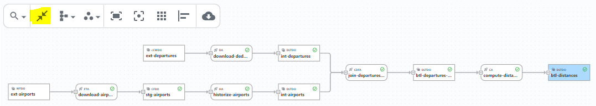

## Goal

SDLB is following a _documentation from metadata and code_ approach. 
In this part, we are going to dive into the role of descriptive metadata in SDLB, and demonstrate how to create this additional metadata and its benefits.
Again it is based on the departures/airports/btl.conf configuration files from the previous steps.

Descriptive metadata, in the context of SDLB, refers to additional configuration attributes, markdown files and generated json files, that go beyond the basic _id_ of DataObjects and Actions.
It is mainly about adding information to document, manage and explore data pipelines effectively in the SDLB UI.

Of course descriptive metadata is not needed to run your data pipeline, but you will see how it will create a nice, up-to-date documentation in the SDLB UI   

## Add metadata for Actions, DataObjects and Transformations

One part of metadata is additional informations for DataObjects, Actions and Transformations. 

Metadata for __Actions__ can include attributes shown in the following example for `join-departures-airports`.
We have already seen the `feed` attribute. The `tags` attribute can take a list of arbitrary tags for your Action.
And to write longer `description`s you can use Hocon's multi-line string syntax.
```
    metadata {
      feed = compute
      name = "Airport Departures Join"
      tags = ["merge", "airports", "coordinates"]
      description = """
        Merging flight details and airport locations.
        Join needs to be done for departure and arrival.
      ""
    }
```

Metadata for __DataObjects__ can include attributes shown in the next example for `ext-departures`.
Again `tags` attribute can take a list of arbitrary tags.
`layer` should be a name for the stage of the DataObject in the data pipeline, e.g. extern/stage/integration/btl according to our convention,
or bronze/silver/gold for the Lakehouse approach.
And `subjectArea` can be used to group DataObjects according to topics or business areas.
```
    metadata = {
      name = "Flight Departures Web Download"
      tags = ["aviation", "flight", "departures"]
      layer = "extern"
      subjectArea = "flight data"
      description = "OpenSky Network flight departures"
    }
```

Metadata for __Transformations__ can be added as `description` attribute in the corresponding configuration,
but it is even nicer to document it right in the code if it is a _ScalaClassSparkDfTransformer_ like `com.sample.ComputeDistanceTransformer`.
See the following _ScalaDoc_ comment already existing in file `src/main/scala/com/sample/ComputeDistanceTransformer.scala`:
```
/**
 * ComputeDistanceTransformer uses method calculateDistanceInKilometer to calculate distance between two GPS coordinates
 * with respect to the earth radius.
 */
class ComputeDistanceTransformer extends CustomDfTransformer {
...
```

To make the Scala documentation available in the UI, the Java command line tool called _ExportSync_
will export a parsed and enriched configuration as Json file, including code comments. Details follow later in this chapter.

Lets now add some descriptions, tags and other metadata to our configuration files.

## Create comprehensive documentation using markdown files

Additionally, we want to create a comprehensive documentation for DataObject `btl-distances`, as the logic could need some explanation.
For this we will write a separate markdown file. The UI will search markdown files for configuration objects according to the
following path convention: `[dataObjects|actions|connections]/<id>.md`, below the directory configured as
`global.descriptionPath`. In this project that directory is `viz/description`. SDLB takes the column descriptions
from there as well, and _ExportSync_ uploads the files to the UI backend.
Let's edit therefore file `viz/description/dataObjects/btl-distances.md`.

The existing file already contains some examples to create titles, tables and include images.
And there is an example of a special syntax to create column descriptions using `@column` keyword.
These column descriptions are merged into the schemas exported by a dry-run with `--test dry-run-with-schema-export`,
which is where the UI shows them from, and are applied as column comments to the catalog by `CatalogSchemaUpdater`, see
[Managing tables in the catalog at deploy time](/docs/reference/schema#managing-tables-in-the-catalog-at-deploy-time).
They override a comment coming from the schema itself.

Lets add an additional comment for column `dep_name` to the markdown.

## Document columns in the code

Writing column descriptions in a markdown file works for any DataObject, but it separates the description from the
code that creates the column. If a column is created from a Scala case class, it is nicer to document it right where
it is defined, in the ScalaDoc of that case class:

```scala
/**
 * A geo location enriched from an address.
 *
 * @param lat  Latitude in decimal degrees, WGS84.
 * @param lon  Longitude in decimal degrees, WGS84.
 */
case class GeoLocation(lat: Double, lon: Double)
```

The `@param` descriptions are used as column comments - for the `caseClass` schema provider, for case classes
returned by user defined functions, and for transformation methods declaring a `Dataset[<CaseClass>]` return value.
See [Column descriptions from ScalaDoc](/docs/reference/schema#column-descriptions-from-scaladoc)
for details, in particular the compiler plugin your project needs for this to work.

## Generate schema and statistics metadata

What would be a DataObject configuration viewer without possibility to see structured DataObject schemas.
Schemas are exported as Json data for SDLB UI by a dry-run of SDLB with `--test dry-run-with-schema-export`.
The dry-run initializes all Actions without processing data, and its schemas include the column documentation.
Table statistics and column statistics are exported from the catalog by a Java command line tool called _CatalogStatsExporter_.
It can export schemas as well with `--withSchema true`, but these schemas are read from the data and lack the column documentation.

To start the schema export, the _CatalogStatsExporter_ and also the configuration export with _ExportSync_, execute the following command:
```
./exportConfigSchemaStats.sh
```

:::tip Scheduling export
Export configuration, schema and statistics at least with every release of your data pipelines.
For this you can easily add the dry-run with schema export, _CatalogStatsExporter_ and _ExportSync_ command line tool in the corresponding release pipeline.
:::

## Export the configuration and synchronize metadata with the UI backend

The Java command line tool _ExportSync_ exports the configuration, and copies the description files, the exported
schemas, statistics and column lineage, as well as the state of the runs, to a target. `--types` selects what is
exported:

- `configJson`: the configuration resolved and enriched with the origin of the configuration objects and the
  documentation of custom classes. It is written to file `exportedConfig.json` if the target is a directory.
- `description`: the markdown files of `global.descriptionPath`. Files no longer existing are deleted on the
  target. This needs a target supporting files, i.e. the UI backend.
- `schema`, `stats`, `lineage`: the documents exported per DataObject, read from `--schemaSource`, which defaults
  to `global.dataObjectsSchemaSource`. The versions which are newer in the source than in the target are
  transferred, so it can be run repeatedly.
- `state`: the state of the runs, read from the state directory given as `--stateSource`.

`configJson,schema,stats,lineage` are exported by default. The target can be `uiBackend` (configured with
`global.uiBackend`), a local directory prefixed with `localfile:`, or a Hadoop path.

After synchronizing, the UI backend rebuilds its search index over the configuration, descriptions and schemas, and
its column lineage index if column lineage was transferred. An unchanged search index is not rebuilt. Disable this
with `--updateSearchIndex false` or `--updateLineageIndex false`. The state of the runs needs no index update, as the
UI backend indexes it on upload.

```
# export the configuration for the local UI
java -cp sdlb.jar io.smartdatalake.meta.configexporter.ExportSync \
  --config ./config --types configJson --target localfile:./viz

# upload configuration, descriptions, schemas, statistics and lineage exported locally, and the state of the runs
java -cp sdlb.jar io.smartdatalake.meta.configexporter.ExportSync \
  --config ./config --schemaSource localfile:./viz/schema --target uiBackend \
  --types configJson,description,schema,stats,lineage,state --stateSource ./viz/state

# download schemas, statistics and lineage from the UI backend
java -cp sdlb.jar io.smartdatalake.meta.configexporter.ExportSync \
  --config ./config --types schema,stats,lineage --schemaSource uiBackend --target localfile:./viz/schema
```

The DataObjects to synchronize are taken from the configuration, and can be filtered with `--includeRegex` and
`--excludeRegex`. The state is synchronized per application, filtered with `--applicationRegex`, and only once
a run has finished. `--versions` selects what is transferred: `newer` (default) transfers all versions newer
than the latest version of the target, `latest` only the latest version of the source, and `all` every version
missing in the target. `--dryRun` only reports what would be transferred.

The state can only be uploaded to the UI backend, not downloaded from it, as the UI backend stores it in a
different format. Between state directories it can be copied in both directions; copied state is added to the
state index file used by the local UI only if the SDL parameter `hadoopFileStateStoreIndexAppend` is set, e.g.
with the environment variable `SDL_HADOOP_FILE_STATE_STORE_INDEX_APPEND=true`, see [Run State](/docs/reference/runState).

## Write the metadata into the data catalog

The descriptions above document your pipeline in the SDLB UI. To make them visible in the data catalog
itself - as table and column comments on the tables SDLB writes - run a second Java command line tool called
_CatalogSchemaUpdater_ in `apply` mode as part of your deployment. It also creates missing tables and applies
schema changes, primary and foreign keys. This is a deployment step and not part of a normal SDLB run, so
that running a pipeline does not repeatedly write to the catalog:

```
java -cp sdlb.jar io.smartdatalake.meta.configexporter.CatalogSchemaUpdater \
  --config ./config,./envConfig/dev.conf --mode plan
```

`--mode plan` reports what would change without changing anything and is the default; `--mode apply` writes
the changes.
See [Managing tables in the catalog at deploy time](/docs/reference/schema#managing-tables-in-the-catalog-at-deploy-time)
for the full flow, including how to export the schemas of tables that do not exist yet.

## SDLB UI

Now it's time to see the result in the SDLB UI.
First you need to download the current version of the SDLB Visualizer using the following command:
```
./updateViz.sh
```

Then you can start a Webserver to serve the SDLB UI on port http://localhost:5000 using the following command:
```
./startViz.sh
```

To stop the Webserver press Ctrl-C.

If something doesn't work as expected, you can also have a look at the official [UI Demo](https://ui-demo.smartdatalake.ch/).

Don't forget to check the [lineage graph](https://ui-demo.smartdatalake.ch/#/config/dataObjects/btl-distances/) of the data pipeline that you have created through this tutorial.
To expand all nodes use the _Expand graph_ button as shown in the following screenshot:



:::note
As the local UI deployment is a static web application without backend service, it needs a listing of all state files.

The state index file is updated at the end of each run by appending a line for the new state file.
Therefore, you can see an SDLB run in the local UI only once it finished ordinarily (SUCCESS or FAILED), but not if the corresponding process was killed.

A configuration index file is not needed as we use _ExportSync_ command line tool to export the configuration.
Don't forget to re-run it in order to have configuration changes reflected in the SDLB UI.

Should you need to re-create the state index file, you can use the following commands:
```
pushd viz
./build_index.sh ./state
popd
```
:::

## Summary

The final solution for departures/airports/btl.conf should look like the files ending with `part-3-solution` in [this directory](https://github.com/smart-data-lake/getting-started/tree/master/config).

In conclusion, descriptive metadata together with a flexible UI is the unsung hero of data pipeline management,
enabling teams to organize and document data more efficiently. 

Soon, the SDLB UI will be available also "as-a-service". Stay tuned!